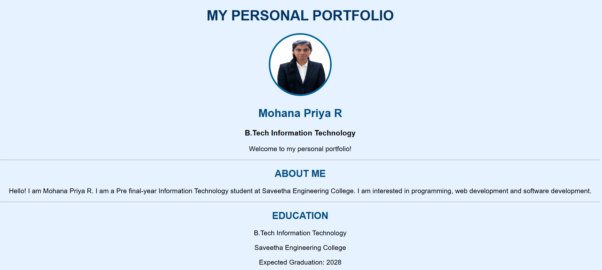
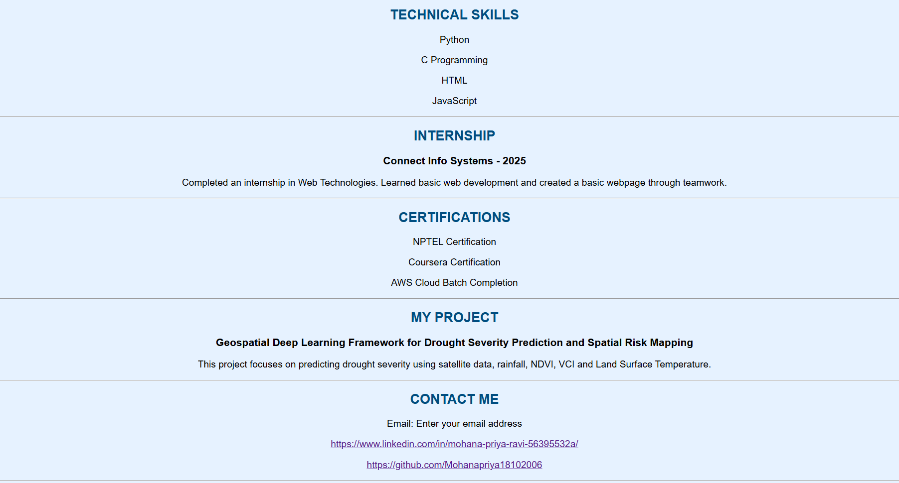

# Ex01 Portfolio
## Date:02-11-2026

## AIM
To create a Portfolio using HTML and CSS.

## ALGORITHM
### STEP 1
Create an HTML file (index.html)

### STEP 2
Create a CSS file (style.css)

### STEP 3
Include a navigation bar with links to different sections.

### STEP 4
Add structured sections for introduction, about, projects, and contact details.

### STEP 5
Define global styles for fonts, colors, and layout.

### STEP 6
Style the header, navigation bar, and sections.

### STEP 7
Use Flexbox or CSS Grid for layout design.

### STEP 8
Add hover effects and transitions for interactivity.

### STEP 9
Add Images and Media.

### STEP 10
Use optimized images for a professional look.

### STEP 11
Open the HTML file in a browser to check layout and functionality.

### STEP 12
Fix styling issues and refine content placement.

### STEP 13
Deploy the Portfolio.

### STEP 14
Upload to GitHub Pages for free hosting.

## PROGRAM
```

<!DOCTYPE html>
<html>
<head>
    <title>Mohana Priya - Portfolio</title>
</head>

<body>

    <center>

        <h1 id="mainTitle">MY PERSONAL PORTFOLIO</h1>

        

        <h2 id="name">Mohana Priya R</h2>

        <h3>B.Tech Information Technology</h3>

        <p>Welcome to my personal portfolio!</p>

        <hr>

        <h2>ABOUT ME</h2>

        <p>
            Hello! I am Mohana Priya R.
            I am a Pre final-year Information Technology student
            at Saveetha Engineering College.
            I am interested in programming, web development
            and software development.
        </p>

        <hr>

        <h2>EDUCATION</h2>

        <p>B.Tech Information Technology</p>
        <p>Saveetha Engineering College</p>
        <p>Expected Graduation: 2028</p>

        <hr>

        <h2>TECHNICAL SKILLS</h2>

        <p>Python</p>
        <p>C Programming</p>
        <p>HTML</p>
        <p>JavaScript</p>

        <hr>

        <h2>INTERNSHIP</h2>

        <h3>Connect Info Systems - 2025</h3>

        <p>
            Completed an internship in Web Technologies.
            Learned basic web development and created
            a basic webpage through teamwork.
        </p>

        <hr>

        <h2>CERTIFICATIONS</h2>

        <p>NPTEL Certification</p>
        <p>Coursera Certification</p>
        <p>AWS Cloud Batch Completion</p>

        <hr>

        <h2>MY PROJECT</h2>

        <h3>
            Geospatial Deep Learning Framework for
            Drought Severity Prediction and Spatial Risk Mapping
        </h3>

        <p>
            This project focuses on predicting drought severity
            using satellite data, rainfall, NDVI, VCI
            and Land Surface Temperature.
        </p>

        <hr>

        <h2>CONTACT ME</h2>

        <p>Email: mpriyar18@gamil.com</p>

        <p>
            <a href="https://www.linkedin.com/in/mohana-priya-ravi-56395532a/">
                https://www.linkedin.com/in/mohana-priya-ravi-56395532a/
            </a>
        </p>

        <p>
            <a href="https://github.com/Mohanapriya18102006">
                https://github.com/Mohanapriya18102006
            </a>
        </p>

        <hr>

        <h2>THANK YOU FOR VISITING!</h2>

    

        <p id="result"></p>

    </center>

    <script>

        // Background colour
        document.body.style.backgroundColor = "#E6F2FF";

        // Font style
        document.body.style.fontFamily = "Arial";

        // Text alignment
        document.body.style.textAlign = "center";

        // Main heading style
        document.getElementById("mainTitle").style.color = "#003366";
        document.getElementById("mainTitle").style.fontSize = "35px";

        // Name style
        document.getElementById("name").style.color = "#006699";
        document.getElementById("name").style.fontSize = "28px";

        // All headings colour
        let headings = document.querySelectorAll("h2");

        headings.forEach(function(heading) {
            heading.style.color = "#004D80";
        });

        // Profile image style
        let photo = document.querySelector("img");

        photo.style.borderRadius = "50%";
        photo.style.border = "4px solid #006699";

        // Paragraph style
        let paragraphs = document.querySelectorAll("p");

        paragraphs.forEach(function(p) {
            p.style.fontSize = "17px";
        });

        // Button style
        let button = document.querySelector("button");

        button.style.backgroundColor = "#006699";
        button.style.color = "white";
        button.style.padding = "12px 25px";
        button.style.border = "none";
        button.style.borderRadius = "8px";
        button.style.cursor = "pointer";

        // JavaScript function
        function showMessage() {

            document.getElementById("result").innerHTML =
            "Thank you for visiting my portfolio!";

            document.getElementById("result").style.color = "#006699";
            document.getElementById("result").style.fontSize = "20px";

        }

    </script>

</body>
</html>
```


## OUTPUT




## RESULT
The program for creating Portfolio using HTML and CSS is executed successfully.